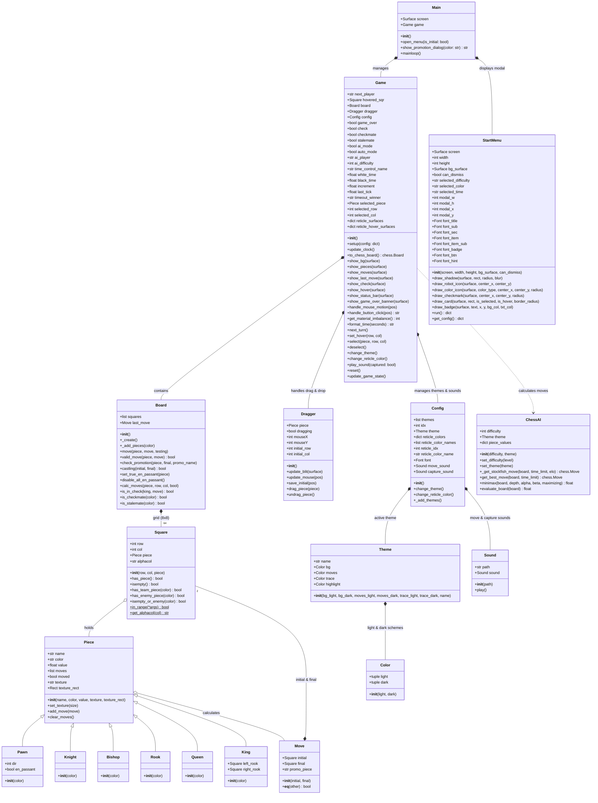

# Chess-AI Class Diagram & Architecture Overview

This document describes the object-oriented architecture, component relationships, and modernized UI design system for the **Chess-AI** application.

---

## 1. Class Diagram (Mermaid)

---

## 2. Interaction Sequence Diagram (Menu & Match Lifecycle)

```mermaid
sequenceDiagram
    autonumber
    actor Player
    participant Main
    participant StartMenu
    participant Game
    participant Board
    participant ChessAI

    Main->>Game: __init__() (instantiates board, config, dragger)
    Main->>Main: open_menu(is_initial=True)
    Main->>Game: render board & piece snapshot (bg_surface)
    Main->>StartMenu: __init__(screen, W, H, bg_surface, can_dismiss=False)
    Main->>StartMenu: run()
    
    rect rgb(35, 45, 30)
        Note over Player,StartMenu: Interactive Glassmorphic Modal Loop
        StartMenu->>StartMenu: render alpha backdrop + drop shadow
        Player->>StartMenu: Select Difficulty (Basic, Intermediate, Advanced)
        Player->>StartMenu: Select Play As (White, Random, Black)
        Player->>StartMenu: Select Time Control (Untimed to 15+10)
        Player->>StartMenu: Click "Start Game" or press [Enter]
    end

    StartMenu-->>Main: return config dict {difficulty, color, time_control}
    Main->>Game: reset()
    Main->>Game: setup(config)
    
    loop Match Execution (mainloop)
        Game->>Game: update_clock()
        Game->>Main: render board, pieces, status bar
        
        alt Player's Turn
            Player->>Game: Drag & drop piece
            Game->>Board: valid_move(piece, move)
            Game->>Board: move(piece, move)
            Game->>Game: play_sound()
            Game->>Game: next_turn()
        else AI's Turn
            Game->>ChessAI: get_best_move(chess_board, time_limit)
            ChessAI-->>Game: return best_move
            Game->>Board: move(ai_piece, ai_move)
            Game->>Game: play_sound()
            Game->>Game: next_turn()
        end
    end
```

---

## 3. Architecture & Component Descriptions

| Component | Responsibility |
| :--- | :--- |
| **`Main`** | Application entry point and primary Pygame loop manager. Orchestrates initial setup, in-game modal triggers (`M` key), pawn promotion modals, and turn dispatching. |
| **`StartMenu`** | Modern glassmorphic setup modal dialog. Renders a dimmed board backdrop, Gaussian drop shadow, tactile card grids with checkmarks/badges, and configuration summary pills. |
| **`Game`** | High-level match state controller. Manages turn alternations, chess clocks with increment, status bar displays, board themes, sound triggers, and win/draw evaluations. |
| **`Board`** | Core chess rulebook engine. Manages the 8x8 matrix of `Square` objects, valid move calculations, check/checkmate detection, castling, en passant, and promotions. |
| **`ChessAI`** | Dual-engine AI architecture. Blends Minimax search with Alpha-Beta pruning & piece-square tables (Levels 1–3) with the Stockfish 17 AVX2 UCI engine (Levels 4–6). |
| **`Square`** | Represents a single tile on the 8x8 grid with row, column, algebraic notation (`a1`–`h8`), and piece occupancy states. |
| **`Piece` & Subclasses** | Polymorphic piece representations (`Pawn`, `Knight`, `Bishop`, `Rook`, `Queen`, `King`) with values, textures, and move lists. |
| **`Move`** | Data structure representing an initial square, final square, and optional pawn promotion piece designation. |
| **`Dragger`** | Manages real-time mouse drag-and-drop interactions, tracking piece positions and visual offsets. |
| **`Config`, `Theme`, `Color`** | Visual styling subsystem supporting dynamic board color palettes (Green, Brown, Blue, Gray) and sound effects. |

---

## 4. UI Design System & Visual Specification

### Color Tokens

| Token | RGB / Hex | Usage |
| :--- | :--- | :--- |
| `c_overlay` | `(14, 13, 11, 215)` | Semi-transparent frosted backdrop over the chess board |
| `c_modal_bg` | `(28, 27, 24)` | Modal card surface background |
| `c_modal_border`| `(58, 54, 48)` | 2px smooth rounded modal card outline |
| `c_card_bg` | `(36, 34, 30)` | Default interactive card fill |
| `c_card_border`| `(54, 51, 45)` | Default card border |
| `c_card_hover` | `(46, 44, 38)` | Hover card fill |
| `c_card_sel_bg`| `(38, 54, 28)` | Selected card olive-emerald tint |
| `c_card_sel_border`| `(129, 182, 76)` | Selected card highlight border |
| `c_accent_green`| `(129, 182, 76)` | Primary action button and indicator accents |
| `c_accent_dark` | `(92, 138, 50)` | Tactile 3D bottom bevel on action buttons |

### Typography & Iconography Hierarchy

- **Title (`26px Bold`):** High-contrast Segoe UI / Arial header (`Play Against AI`).
- **Section Headers (`12px Bold`):** Uppercase category markers (`1. CHOOSE DIFFICULTY`, etc.).
- **Item Titles (`15px Bold`) & Subtitles (`11px`):** High-contrast active text with secondary descriptions.
- **Pill Badges (`10px Bold`):** Colored tags (`LVL 2`, `LVL 4`, `LVL 6`) indicating exact AI difficulty tiers.
- **Vector Icons:** Fully drawn vector icons (clean geometric robot badge, 3D color discs, checkmarks, play triangle, and vector `✕` close button) ensuring resolution independence across all platforms.
