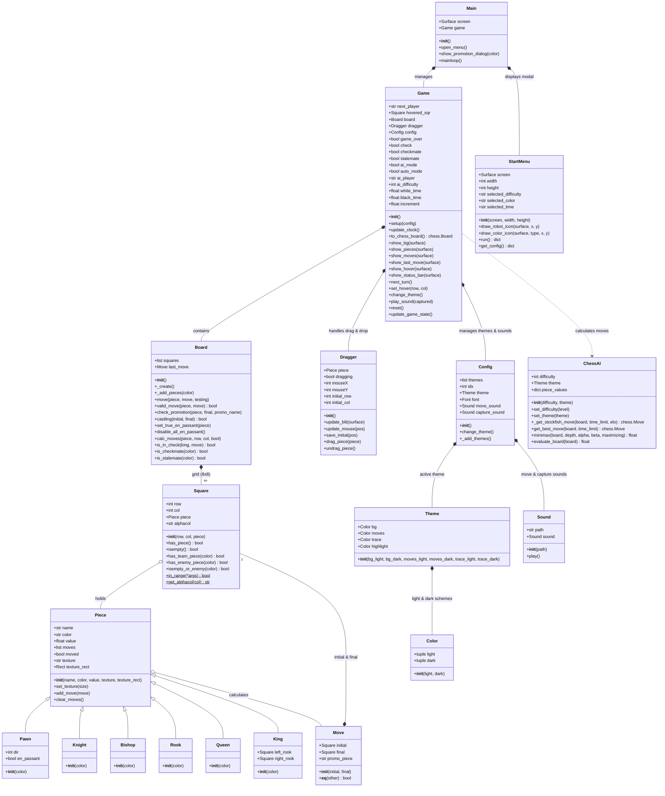

# Chess-AI Class Diagram & Architecture Overview

This document describes the updated object-oriented architecture and class relationships for the **Chess-AI** application.

---

## 1. Class Diagram (Mermaid)

---

## 2. Architecture & Component Descriptions

| Component | Responsibility |
| :--- | :--- |
| **`Main`** | Application entry point and main Pygame loop executor. Coordinates between `StartMenu` and `Game`. |
| **`StartMenu`** | Dark setup modal UI. Configures AI difficulty, player color, and match time control. |
| **`Game`** | High-level match state controller. Handles turn switching, live countdown clocks, rendering, hover states, themes, and sound triggers. |
| **`Board`** | Core chess rulebook engine. Manages 8x8 grid of `Square` objects, valid move calculations, check/checkmate detection, castling, en passant, and promotions. |
| **`ChessAI`** | Dual-engine AI system. Supports 6 Elo rating levels ranging from Minimax lookahead (Levels 1–3) to Stockfish 17 UCI engine (Levels 4–6). |
| **`Square`** | Represents a single tile on the 8x8 grid with row, column, algebraic notation (`a1`-`h8`), and piece occupancy state. |
| **`Piece` & Subclasses** | Polymorphic piece representations (`Pawn`, `Knight`, `Bishop`, `Rook`, `Queen`, `King`) with values, textures, and move lists. |
| **`Move`** | Represents a move from an initial `Square` to a final `Square` with optional promotion piece designation. |
| **`Dragger`** | Manages interactive mouse drag-and-drop mechanics for pieces on screen. |
| **`Config`, `Theme`, `Color`** | Visual styling system supporting multiple board color palettes (Green, Brown, Blue, Gray). |
